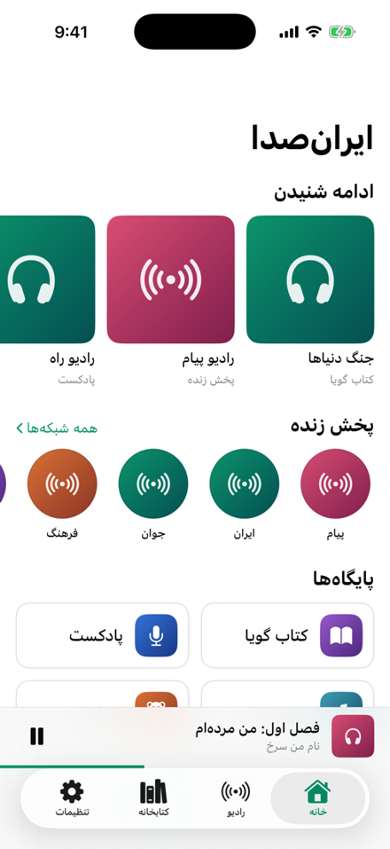
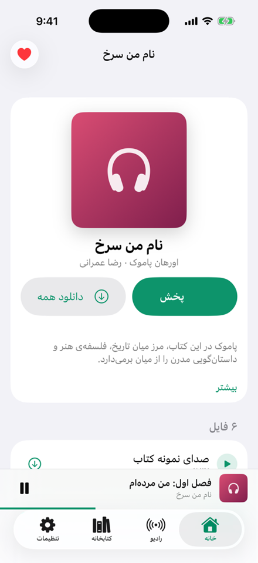
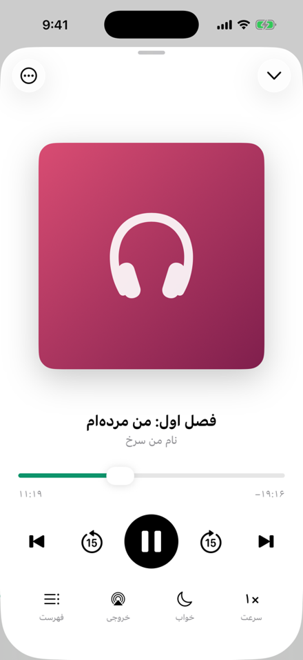
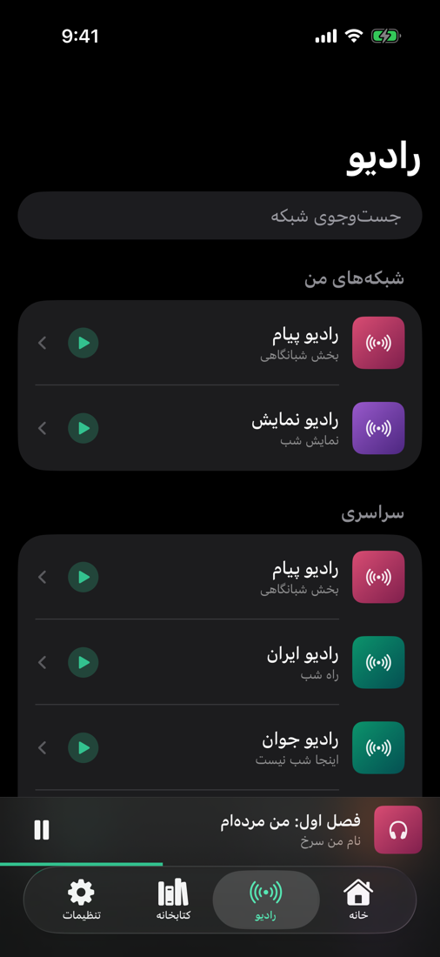

# Seda+

[](https://github.com/majidkabir/iranseda-ios/actions/workflows/build.yml)
[](LICENSE)

An unofficial, open-source iOS client for [Iran Seda](https://iranseda.ir), the online radio and audio library of Iranian national radio. Built with SwiftUI.

The official app is Android-only; this one brings the same content to the iPhone.

<p>
  
  
  
  
</p>

Screenshots use built-in sample data, so covers appear as coloured tiles.

> **Unofficial.** This project is not affiliated with, endorsed by, or connected to IRIB or Iran Seda.
> All audio, text and images shown in the app come from their service and belong to their owners.
> The repository contains no content, logos or code from the official app.

## Features

- **Live radio:** every national and provincial station, with what is on air now
- **Per station:** schedule, programme list and an hour-by-hour archive
- **Audio library:** audiobooks, podcasts, music, kids, Quran, talks and the other hubs the service lists
- **Player:** background audio, lock-screen controls, 15-second skip, playback speed, sleep timer, AirPlay, resume where you stopped
- **Offline:** download files with progress, play them without a connection
- **Search:** the whole catalogue of every hub (titles, authors, narrators), plus stations
- **Library:** favourites, listening history and where you stopped — shared between iPhone and watch through your iCloud
- **Fast:** covers and logos are cached on disk; long lists load page by page
- **Widget:** continue listening and favourite stations on the home screen
- **Apple Watch:** a full app that works without the iPhone — radio, hubs, search, favourites, downloads — over the watch's Wi-Fi or cellular, to Bluetooth headphones or the watch speaker
- **Persian, right-to-left UI** with dark mode and large text sizes

Not there yet: comments and likes. CarPlay is written but needs an entitlement from Apple ([docs/CARPLAY.md](docs/CARPLAY.md)). See [open issues](https://github.com/majidkabir/iranseda-ios/issues).

## Build and run

Requirements: Xcode 26 or later, iOS 17 / watchOS 10 or later, [XcodeGen](https://github.com/yonaskolb/XcodeGen).

```sh
git clone https://github.com/majidkabir/iranseda-ios.git
cd iranseda-ios
brew install xcodegen
xcodegen            # creates IranSeda.xcodeproj from project.yml
open IranSeda.xcodeproj
```

In Xcode, select the IranSeda target, set your own Team under Signing & Capabilities, and change the identifiers in `project.yml` (`com.majidkabir.iranseda`, its `.widget`, `.watchkitapp` and `group.` forms, also in `Shared/WidgetSnapshot.swift`) to your own. Then run on a simulator or device.

To try the app without the network, add the launch arguments `-demo YES`.

To install on your own iPhone through TestFlight from GitHub Actions, see [docs/TESTFLIGHT.md](docs/TESTFLIGHT.md).

## Project layout

| Path | What is in it |
| --- | --- |
| `IranSeda/Core` | API client, models, player, downloads, favourites, demo data |
| `IranSeda/UI` | Shared components: artwork, loader, buttons |
| `IranSeda/Views` | Screens: home, radio, search, detail, player, library, settings |
| `IranSedaWatch` | Apple Watch app: its own screens on the same core code |
| `IranSedaWidget`, `Shared` | Home-screen widget and the data it shares with the app |
| `.github/workflows` | CI build, simulator screenshots, TestFlight upload |
| `docs` | API notes, TestFlight and CarPlay guides, screenshots |

The service's API is undocumented. What this app relies on is written down in [docs/API.md](docs/API.md).

## Contributing

Issues and pull requests are welcome. Start with [CONTRIBUTING.md](CONTRIBUTING.md).

## License

[MIT](LICENSE) for the code in this repository. The licence does not cover the content the app plays.
